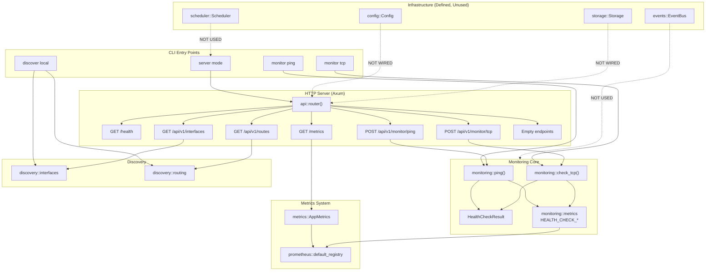

# Netwatch Architecture

This document describes the **current architecture** (as implemented) and the **target architecture** (to support the 16 strategic objectives). It separates verified implementation from design proposals.

---

## Current Architecture (Implemented)

### Module Map

```
src/
├── main.rs              # CLI entry point, HTTP server bootstrap
├── lib.rs               # Module declarations
├── config.rs            # YAML configuration structures (NOT WIRED)
├── logging.rs           # Tracing subscriber init
├── api.rs               # Axum router + handlers
├── metrics.rs           # AppMetrics (Prometheus)
├── storage.rs           # SQLite pool + migrations (NOT WIRED)
├── scheduler.rs         # Job queue + worker pool (NOT USED)
├── events.rs            # Broadcast EventBus (NOT USED)
├── monitoring/
│   ├── mod.rs           # HealthCheckResult, re-exports
│   ├── icmp.rs          # ping() via system `ping` binary
│   ├── tcp.rs           # check_tcp() via Tokio TcpStream
│   └── metrics.rs       # Health check Prometheus metrics (lazy)
├── discovery/
│   ├── mod.rs           # Re-exports
│   ├── interfaces.rs    # discover_interfaces() via if_addrs + /sys
│   └── routing.rs       # discover_routes() via /proc/net/route
```

### Component Responsibilities

| Module | Responsibility | Status |
|--------|----------------|--------|
| `main.rs` | CLI parsing, command dispatch, HTTP server startup | ✅ Working |
| `config.rs` | Typed YAML config with defaults | ⚠️ Defined, not integrated |
| `api.rs` | HTTP routes, request/response, metrics side-effects | ✅ Core endpoints working |
| `metrics.rs` | AppMetrics (uptime, info, scheduler counters) | ✅ Working |
| `monitoring/*` | ICMP/TCP checks, HealthCheckResult, Prometheus metrics | ✅ Working |
| `discovery/*` | Local interface & route discovery | ✅ Working (Linux-only) |
| `storage.rs` | SQLite connection, migrations, WAL + FK | ⚠️ Defined, not used |
| `scheduler.rs` | Periodic job execution, concurrency control | ⚠️ Defined, not instantiated |
| `events.rs` | In-memory broadcast event bus | ⚠️ Defined, no emitters/subscribers |

### Execution Flows

#### CLI ICMP Check
```
main()
  → Cli::parse()
  → match MonitorKind::Ping { target }
  → monitoring::ping(&target, 2000).await
  → tokio::process::Command::new("ping") -c 1 -w <sec> <target>
  → parse stdout regex `time=([\d.]+)`
  → HealthCheckResult { protocol: "icmp", ... }
  → HEALTH_CHECK_TOTAL.with_label_values(&["icmp"]).inc()
  → if !success: HEALTH_CHECK_FAILURES_TOTAL.inc()
  → if latency: HEALTH_CHECK_LATENCY_SECONDS.observe(latency_sec)
  → println!(JSON)
```

#### HTTP ICMP Check
```
POST /api/v1/monitor/ping
  → ping_handler(Json(req))
  → monitoring::ping(&req.target, req.timeout_ms).await
  → same as CLI → Json(res)
  → metrics recorded via same static counters
```

#### Metrics Exposition
```
GET /metrics
  → AppMetrics::metrics_handler(uptime, start_time)
  → prometheus::default_registry().gather()
  → TextEncoder::encode()
  → Returns: AppMetrics + health check metrics (if registered)
```

### Data Flow Diagram (Current)



### Persistence Schema (Migrations)

`migrations/20231006000000_initial.sql` creates 11 tables:

| Table | Purpose | Key Columns |
|-------|---------|-------------|
| `sites` | Physical/logical locations | id, name |
| `networks` | CIDR blocks | id, cidr |
| `vlans` | VLAN definitions | id, number, name |
| `devices` | Discovered/inventoried devices | id, hostname, ip, mac, type, source, confidence |
| `interfaces` | Device interfaces | id, device_id (FK), name, mac, mtu, state |
| `services` | Monitored services/ports | id, device_id (FK), port, protocol, name, status |
| `events` | Incident/event log | id, device_id (FK), type, severity, timestamp, message |
| `topology_edges` | Graph relationships | id, source_id, target_id, relationship, confidence, evidence |
| `observations` | Metric samples | id, device_id (FK), metric, value, source, confidence |
| Indexes on: `devices(ip)`, `interfaces(name)`, `services(port)`, `events(timestamp)` |

**Current gap:** No code writes to these tables. API handlers return `[]`.

### Metrics Catalog (Current)

| Metric | Type | Labels | Trigger |
|--------|------|--------|---------|
| `netwatch_info` | Gauge | — | Server start |
| `netwatch_uptime_seconds` | Gauge | — | Each `/metrics` scrape |
| `netwatch_scheduler_jobs_total` | Counter | — | Never (scheduler unused) |
| `netwatch_scheduler_errors_total` | Counter | — | Never (scheduler unused) |
| `netwatch_health_checks_total` | Counter | `protocol` | Every ping/tcp check |
| `netwatch_health_check_failures_total` | Counter | `protocol` | Failed check |
| `netwatch_health_check_latency_seconds` | Histogram | `protocol` | Successful check with latency |

**Cardinality policy:** Only `protocol` (values: "icmp", "tcp") is a dynamic label. Enforced by tests.

---

## Target Architecture (Design)

### High-Level Modules

```
netwatch/
├── config/              # Typed config, validation, hot-reload, precedence
├── domain/              # Core models: Device, Service, Check, Incident, Topology, SLO
├── storage/             # Repositories, migrations, transactions, retention
├── discovery/           # Incremental discovery, topology builder, diff engine
├── monitoring/          # Collectors: ICMP, TCP, DNS, HTTP, SNMP, Synthetic
├── scheduler/           # Cron-like scheduler, jitter, backoff, graceful shutdown
├── history/             # Aggregations, percentiles, SLO computations, retention
├── events/              # Typed event contracts, versioning, emission
├── incidents/           # State machine, deduplication, correlation, ACK, resolve
├── notifications/       # Adapters: Telegram, Webhook, Alertmanager (pluggable)
├── api/                 # REST v1, OpenAPI, auth, validation, pagination
├── metrics/             # Prometheus exporter, cardinality guard, custom registry
├── topology/            # Graph, dependency analysis, export (Mermaid/DOT/JSON)
├── security/            # Secrets, RBAC, SSRF protection, rate limits
├── observability/       # Structured logs, traces, diagnostics, profiling
└── cli/                 # Admin, one-shot checks, config validate, diag
```

### Module Boundaries & Interfaces

```
┌─────────────────────────────────────────────────────────────────┐
│                        EXTERNAL INTEGRATIONS                     │
│  ┌──────────┐  ┌──────────┐  ┌──────────┐  ┌──────────┐         │
│  │ Prometheus│  │ Grafana  │  │ Alertmgr │  │ Telegram │         │
│  └────┬─────┘  └────┬─────┘  └────┬─────┘  └────┬─────┘         │
└───────┼─────────────┼─────────────┼─────────────┼────────────────┘
        │             │             │             │
        ▼             ▼             ▼             ▼
┌─────────────────────────────────────────────────────────────────┐
│                         ADAPTER LAYER                            │
│  ┌──────────────┐  ┌──────────────┐  ┌──────────────┐           │
│  │MetricsExporter│  │DashboardProv │  │AlertRouter   │           │
│  └──────┬───────┘  └──────┬───────┘  └──────┬───────┘           │
└─────────┼─────────────────┼─────────────────┼────────────────────┘
          │                 │                 │
          ▼                 ▼                 ▼
┌─────────────────────────────────────────────────────────────────┐
│                         CORE DOMAIN                              │
│  ┌──────────┐ ┌──────────┐ ┌──────────┐ ┌──────────┐           │
│  │ Scheduler │ │ Monitoring│ │ Discovery │ │ Incidents │           │
│  └────┬─────┘ └────┬─────┘ └────┬─────┘ └────┬─────┘           │
└───────┼─────────────┼─────────────┼─────────────┼────────────────┘
        │             │             │             │
        ▼             ▼             ▼             ▼
┌─────────────────────────────────────────────────────────────────┐
│                       PERSISTENCE LAYER                          │
│  ┌──────────────┐  ┌──────────────┐  ┌──────────────┐           │
│  │ SQLite (primary)│  │ Kafka (opt)  │  │ Object Store │          │
│  └──────────────┘  └──────────────┘  └──────────────┘           │
└─────────────────────────────────────────────────────────────────┘
```

### Key Interfaces (Traits for Swappable Adapters)

```rust
// Monitoring collectors
#[async_trait]
trait Collector: Send + Sync {
    type Config;
    type Result;
    async fn check(&self, target: &Target, cfg: &Self::Config) -> Result<Self::Result>;
    fn protocol(&self) -> &'static str;
}

// Event delivery
#[async_trait]
trait EventSink: Send + Sync {
    async fn emit(&self, event: Event) -> Result<()>;
    fn name(&self) -> &'static str;
}

// Notification delivery
#[async_trait]
trait Notifier: Send + Sync {
    async fn notify(&self, incident: &Incident, event: &IncidentEvent) -> Result<()>;
}

// Topology export
trait TopologyExporter: Send + Sync {
    fn export_mermaid(&self, graph: &TopologyGraph) -> String;
    fn export_dot(&self, graph: &TopologyGraph) -> String;
    fn export_json(&self, graph: &TopologyGraph) -> serde_json::Value;
}
```

### Data Flows (Target)

#### Scheduled Monitoring
```
Scheduler (tick)
  → for each (device, service) in registry:
      → spawn check task (semaphore-limited)
      → Collector::check() → CheckResult
      → HistoryRepository::record(result)
      → Events::emit(CheckCompleted { result })
      → if threshold breached: Events::emit(ThresholdBreached { ... })
```

#### Incident Lifecycle
```
ThresholdBreached / CheckFailed / TopologyChange
  → IncidentEngine::process(event)
  → dedup_key + cooldown check
  → correlation: find related open incidents (shared gateway/subnet)
  → create Incident { state: Open, evidence: [...] }
  → Events::emit(IncidentOpened { incident })
  → Notifier::notify(incident, IncidentEvent::Opened)
  → ...
  → CheckRecovered → IncidentEngine::resolve(incident)
  → Events::emit(IncidentResolved { incident })
  → Notifier::notify(incident, IncidentEvent::Resolved)
```

#### Topology Build
```
DiscoveryScheduler (interval)
  → Discovery::run() → DiscoveredData { interfaces, routes, neighbors, snmp }
  → TopologyBuilder::merge(current, discovered)
  → for each change: Events::emit(TopologyChanged { diff })
  → TopologyRepository::persist(graph)
```

### Persistence Strategy

| Data Type | Primary Store | Retention | Notes |
|-----------|---------------|-----------|-------|
| Inventory (devices, interfaces, services) | SQLite | Forever | Source of truth |
| Check observations (raw) | SQLite | 7d (configurable) | High volume; batch inserts |
| Aggregated metrics (hourly/daily) | SQLite | 13mo | Materialized views |
| Events/Incidents | SQLite | 3y | Audit trail |
| Topology snapshots | SQLite | 90d | Diff baseline |
| Prometheus metrics | Prometheus TSDB | 30d (config) | Operational dashboards |
| Kafka events | Kafka | 7d (config) | Audit/stream processing |

**Transactional outbox pattern** for SQLite → Kafka: write event to `outbox` table in same transaction as domain change; Kafka publisher reads outbox.

### Security Model

| Layer | Controls |
|-------|----------|
| API | Optional auth (Bearer token / mTLS), rate limiting, body size limits, CORS |
| Config | Secrets via env/file only; never in YAML; redacted in logs |
| Collectors | Allowlist targets (from inventory); no arbitrary host/port from API |
| Containers | Non-root, read-only rootfs, dropped capabilities |
| Network | Internal Docker network; only API port exposed; Kafka/Prometheus internal |
| Dependencies | `cargo audit` in CI; `cargo deny` for licenses; pinned versions |

### Configuration Precedence

1. Compile-time defaults (`Config::default()`)
2. Config file (`--config` or `$HOME/.config/netwatch/netwatch.yaml`)
3. Environment variables (`NETWATCH_*` prefix)
4. CLI flags (for server: `--listen`, `--log-level`)

Hot-reloadable: log level, scheduler intervals, check timeouts, collector config.
Requires restart: listen address, storage path, TLS certs.

### Error Handling Strategy

- **Expected failures** (target down, timeout): `CheckResult { success: false, error: Some(...) }` — not an `Err`
- **Infrastructure failures** (DB down, Kafka down): `Result::Err` → logged, metrics incremented, scheduler pauses affected jobs
- **Config errors**: Fail fast at startup with actionable message
- **Unknown states**: Modeled explicitly (e.g., `CheckStatus::Unknown`, `DeviceState::Unknown`)

### Observability Built-In

- **Logs**: Structured JSON (tracing), correlation IDs propagated
- **Metrics**: Prometheus exposition, cardinality-guarded, exemplars for traces
- **Traces**: OpenTelemetry-ready (future), span per check/incident
- **Diagnostics**: `/debug/vars`, `/debug/pprof` (dev only), config dump (sanitized)

---

## Evolution Path (Current → Target)

| Step | Action | Unlocks |
|------|--------|---------|
| 1 | Wire `Config` to `main.rs` (`--config`, env override) | P0 foundation |
| 2 | Initialize `Storage` at startup, pass to API handlers | Persistent inventory |
| 3 | Instantiate `Scheduler`, register monitoring jobs | Periodic checks |
| 4 | Persist `CheckResult` to `observations` table | Historical data |
| 5 | Implement `EventBus` emitters in monitoring/scheduler | Event-driven core |
| 6 | Build `IncidentEngine` consuming events | Alerting |
| 7 | Add Telegram notifier + Alertmanager integration | Notifications |
| 8 | Dockerfile + compose profiles | Deployable stack |
| 9 | Prometheus rules + Grafana dashboards | Observability |
| 10 | SNMP collector + inventory enrichment | Infrastructure visibility |
| 11 | Topology graph builder + exports | Live map |
| 12 | SLA/SLO calculator + error budget alerts | Objective 1 |
| 13 | Maintenance/silence engine | Objective 12 |
| 14 | Change audit + drift detection | Objective 11 |
| 15 | Incident report generator | Objective 15 |
| 16 | Backup/restore scripts + CI drill | Objective 16 |
| 17 | Synthetic collectors (HTTP, DNS, TLS) | Objective 13 |
| 18 | Anomaly detectors + baselines | Objective 7 |
| 19 | Root cause hypotheses | Objective 10 |
| 20 | Distributed agent protocol | Objective 9 |
| 21 | Traffic analysis (NetFlow/sFlow) | Objective 6 |

---

## Decisions & Trade-offs

| Decision | Rationale | Revisit When |
|----------|-----------|--------------|
| Monolithic binary (not microservices) | Simpler deployment, debugging, testing; split only when scaling demands | Team >5, distinct scaling profiles |
| SQLite for primary persistence | Zero-ops, embedded, ACID, WAL supports concurrent readers | Write throughput >10k ops/s |
| `prometheus::default_registry()` | Simplicity; shared with health check metrics | Custom registry needed for multi-tenant |
| System `ping` for ICMP | No CAP_NET_RAW needed; works in containers with `--cap-add=NET_RAW` | Raw socket implementation for portability |
| Linux-only discovery (`/sys`, `/proc`) | MVP scope; cross-platform later via `rtnetlink`/`getifaddrs` | Windows/macOS agent requirement |
| Broadcast channel for events | In-process, zero-dep, sufficient for single-node | Multi-node → Kafka/NATS |
| No auth in MVP | Internal tool assumption; add when exposing externally | Public/network exposure |

---

## Limitations (Current)

1. **Config not wired** — Server ignores `Config` struct; hardcoded 0.0.0.0:8080, log level "info"
2. **Storage not wired** — API returns empty arrays; no persistence of checks
3. **Scheduler not running** — No periodic execution; ad-hoc only
4. **EventBus unused** — No event emission or subscription
5. **No authentication/TLS** — All endpoints open, HTTP only
6. **No graceful shutdown** — SIGINT kills process mid-check
6. **Linux-only discovery** — `/sys/class/net`, `/proc/net/route`
7. **ICMP requires `ping` binary** — No raw socket fallback
8. **No config hot-reload** — Restart required for any change
9. **Placeholders for 6 API endpoints** — `/devices`, `/vlans`, `/subnets`, `/gateways`, `/events`, `/topology`

---

## References

- [Implementation Status](IMPLEMENTATION_STATUS.md) — Per-objective verification
- [Roadmap](ROADMAP.md) — Phases, acceptance criteria, risks
- [Architecture Audit](ARCHITECTURE_AND_FUNCTIONAL_TESTS.md) — Full code-backed audit
- [Development Guide](DEVELOPMENT.md) — Build/test commands