# Netwatch - Architecture and Functional Audit

**Generated:** 2026-10-11
**Version:** 0.1.0
**Status:** Code-backed audit of actual implementation (UPDATED post-P0/P1/P2/P3 implementation)

---

## 1. Functionality Overview

### 1.1 CLI

**Implemented Commands:**
- `netwatch monitor ping <target>` — ICMP echo request to target
- `netwatch monitor tcp <host> <port>` — TCP connection test
- `netwatch discover local` — Local interface and route discovery
- `netwatch` (no subcommand) — Start HTTP server with full scheduling, persistence, topology, drift detection

**Partially Implemented:** None
**Missing:** No config file override via interactive CLI (use `--config` flag), no persistent scheduling management via CLI

### 1.2 HTTP API

**Implemented Endpoints:**
- `GET /health` — Health check (`{"status":"ok"}`)
- `GET /api/v1/interfaces` — Discovered network interfaces
- `GET /api/v1/routes` — Discovered routing table
- `GET /api/v1/devices` — Devices from SQLite database (real data)
- `POST /api/v1/monitor/ping` — ICMP ping with JSON body
- `POST /api/v1/monitor/tcp` — TCP probe with JSON body
- `GET /metrics` — Prometheus metrics exposition

**Placeholder Endpoints (return empty arrays):**
- `GET /api/v1/vlans`
- `GET /api/v1/subnets`
- `GET /api/v1/gateways`
- `GET /api/v1/events`
- `GET /api/v1/topology`

### 1.3 ICMP

**Implementation:** `src/monitoring/icmp.rs::ping()`
- Uses system `ping` command (`ping -c 1 -w <timeout_sec> <target>`)
- Parses latency from stdout regex `time=([\d.]+)`
- Returns `HealthCheckResult` with protocol="icmp", evidence="icmp"
- Timeout handled via `-w` flag (seconds, ceiling of ms)

**Limitations:** Requires `ping` binary, Linux-only, no raw socket implementation

### 1.4 TCP

**Implementation:** `src/monitoring/tcp.rs::check_tcp()`
- Uses `tokio::net::TcpStream::connect()` with `tokio::time::timeout`
- Returns `HealthCheckResult` with protocol="tcp", evidence="tcp_probe"
- Latency measured via `std::time::Instant`

### 1.5 DNS

**Implementation:** `src/monitoring/dns.rs::check_dns()`
- Uses `hickory_resolver` with system configuration (resolv.conf)
- Supports A, AAAA, CNAME, MX, TXT, NS record types
- Optional expected IPs validation
- Returns `HealthCheckResult` with protocol="dns", evidence="dns_probe"

### 1.6 HTTP

**Implementation:** `src/monitoring/http.rs::check_http()`
- Uses `reqwest::Client` with configurable timeout, redirects (max 10)
- Supports expected status code, expected body substring, custom headers
- Per-phase timing available via `check_http_with_phases()`
- Returns `HealthCheckResult` with protocol="http"/"https", evidence="http_probe"

### 1.7 TLS

**Implementation:** `src/monitoring/tls.rs::check_tls()`
- Uses `rustls` + `tokio-rustls` with native CA certificates
- Certificate expiry check with configurable warning days
- Hostname verification via SAN
- Returns `HealthCheckResult` with protocol="tls", evidence="tls_probe"
- Full check via `check_tls_full()` (30 days expiry warning, hostname verify)

### 1.8 Discovery

**Interface Discovery:** `src/discovery/interfaces.rs::discover_interfaces()`
- Uses `if_addrs::get_if_addrs()` for IP addresses
- Reads `/sys/class/net/<name>/operstate`, `address`, `mtu` for metadata
- Returns `LocalInterface` structs with name, oper_state, ipv4, ipv6, mac, mtu, evidence="local_interface"

**Route Discovery:** `src/discovery/routing.rs::discover_routes()`
- Parses `/proc/net/route`
- Returns `RouteEntry` structs with destination, gateway, interface, metric, mask, evidence="routing_table"
- Linux-specific implementation

### 1.9 Metrics

**AppMetrics** (`src/metrics.rs`): Always exposed
- `netwatch_info` (gauge) — Instance info
- `netwatch_uptime_seconds` (gauge) — Uptime in seconds (updates on each /metrics scrape via `Instant::elapsed()`)
- `netwatch_scheduler_jobs_total` (counter) — Scheduler jobs started
- `netwatch_scheduler_errors_total` (counter) — Scheduler errors

**Health Check Metrics** (`src/monitoring/metrics.rs`): Lazily registered on first use
- `netwatch_health_checks_total{protocol}` (counter) — Total checks per protocol
- `netwatch_health_check_failures_total{protocol}` (counter) — Failures per protocol
- `netwatch_health_check_latency_seconds{protocol}` (histogram) — Latency per protocol

**Protocol label values:** "icmp", "tcp", "dns", "http", "https", "tls"

### 1.10 Config

**Implementation:** `src/config.rs`
- Complete YAML configuration structure with all subsystems
- `Config::from_path()` for loading from file
- `Config::default()` provides sensible defaults
- Environment variable overrides: `NETWATCH_STORAGE_PATH`, `NETWATCH_LOG_LEVEL`, `NETWATCH_LISTEN`
- **WIRED** to server — `--config` flag loads YAML, applies to listen address, log level, intervals

### 1.11 Storage

**Implementation:** `src/storage.rs`
- SQLite with sqlx, WAL mode, foreign keys
- Migrations in `migrations/20231006000000_initial.sql` (11 tables) and `migrations/20241009000000_topology.sql` (3 tables)
- Tables: sites, networks, vlans, devices, interfaces, services, events, topology_edges (legacy), observations, topology_nodes, topology_edges, topology_snapshots
- **WIRED** to API handlers — `devices_handler` queries `devices` table; scheduler persists observations

### 1.12 Scheduler

**Implementation:** `src/scheduler.rs`
- `Scheduler` struct with job queue, worker pool, semaphore-based concurrency
- `Job` struct with name, interval, async task (`BoxFuture`)
- Graceful shutdown via `tokio::sync::Notify`
- **RUNNING** — instantiated in `main()` via `Scheduler::new()`, 6 jobs registered in `register_monitoring_jobs()`, runs in background tokio task

**Registered Jobs (from `register_monitoring_jobs()` in `main.rs`):**
1. `health_check_icmp` — ICMP ping to 127.0.0.1 (hardcoded)
2. `health_check_http` — HTTP GET to http://127.0.0.1:8080/health (hardcoded)
3. `health_check_dns` — DNS A record for localhost (hardcoded)
4. `health_check_tls` — TLS check on localhost:8080 (hardcoded)
5. `topology_discovery` — Build topology from discovery + create snapshot
6. `snmp_poll` — Placeholder (logs debug, no real polling)

**Note:** All health check targets are hardcoded to localhost/127.0.0.1. Per-device/service scheduling requires inventory (Objective 5) and is planned for P1+.

### 1.13 Events

**Implementation:** `src/events.rs`
- `EventBus` with tokio broadcast channel (capacity 1000)
- `emit()` and `subscribe()` methods
- Typed event schema v1 with: id, schema_version, event_type, timestamps, entity, severity, state, source, evidence, dedup_key, correlation_id, trace_id, metadata
- Event types: CheckCompleted, CheckFailed, ThresholdBreached, ThresholdRecovered, DeviceDiscovered, DeviceLost, InterfaceChanged, RouteChanged, TopologyChanged, IncidentOpened, IncidentAcknowledged, IncidentResolved, IncidentClosed, CollectorError, CollectorRecovered, SchedulerError, ConfigChanged, MaintenanceWindowStart, MaintenanceWindowEnd
- Helper methods: `emit_check_completed()`, `emit_threshold_breached()`, `emit_collector_error()`
- **EMITTING** — scheduler jobs emit check events; topology builder emits topology change events

### 1.14 Incidents

**Implementation:** `src/incidents.rs`
- `IncidentState` enum: Open, Acknowledged, Resolved, Closed with valid transitions
- `Incident` struct with full lifecycle fields (dedup_key, correlation_id, evidence, labels, timestamps, transitions, cooldown_until, silence_until)
- `IncidentStore` for SQLite persistence (create, find_by_dedup_key, find_by_id, update, list_open)
- State machine enforces valid transitions; ACK/resolve/reopen with actor/reason tracking
- **NOT CONNECTED** to EventBus — no subscriber consumes events to create/update incidents

### 1.15 Topology

**Implementation:** `src/topology.rs`, `src/topology_builder.rs`, `src/topology_store.rs`
- `TopologyNode`: id, type (Device/Interface/Subnet/Gateway), label, properties, state (Online/Degraded/Offline/Unknown), timestamps
- `TopologyEdge`: id, source, target, type (Contains/ConnectedTo/RoutesThrough/L2Adjacency/GatewayOf/DependsOn), provenance (Arp/Ndp/Snmp/Lldp/RoutingTable/Manual/Discovery), confidence, timestamps
- `TopologyGraph`: petgraph-based DiGraph with node indices, diff capability
- `TopologyBuilder`: builds from discovery (interfaces, routes) and SNMP; persists to store; exports Mermaid/DOT/JSON
- `TopologyStore`: upsert nodes/edges, snapshots (JSON), diff with latest, list nodes/edges
- **WORKING** — topology built on schedule, snapshots created, exports functional

### 1.16 Drift Detection

**Implementation:** `src/drift.rs`
- `ExpectedInventory`: devices, interfaces, routes, subnets with expected properties
- `DriftDetector`: compares expected vs actual topology nodes
- `DriftFinding`: id, type (Added/Removed/Modified/Unexpected), severity, entity details, expected/actual values, confidence, description
- `DriftReport`: findings + summary (counts by type/severity/entity), JSON + Markdown export
- **COMPLETE** — detects added/removed/modified devices, interfaces, subnets; exports work

---

## 2. Architecture Diagram

```mermaid
graph TB
    subgraph CLI["CLI Entry Points"]
        CLI_PING["monitor ping"]
        CLI_TCP["monitor tcp"]
        CLI_DISC["discover local"]
        CLI_SERVER["server mode"]
    end

    subgraph HTTP["HTTP Server (Axum)"]
        API_ROUTER["api::router(storage)"]
        HEALTH["GET /health"]
        INTERFACES["GET /api/v1/interfaces"]
        ROUTES["GET /api/v1/routes"]
        DEVICES["GET /api/v1/devices (from DB)"]
        PING_API["POST /api/v1/monitor/ping"]
        TCP_API["POST /api/v1/monitor/tcp"]
        METRICS_EP["GET /metrics"]
        PLACEHOLDERS["Empty endpoints: vlans, subnets, gateways, events, topology"]
    end

    subgraph MONITORING["Monitoring Core"]
        PING_FN["monitoring::ping()"]
        TCP_FN["monitoring::check_tcp()"]
        DNS_FN["monitoring::check_dns()"]
        HTTP_FN["monitoring::check_http()"]
        TLS_FN["monitoring::check_tls()"]
        HC_RESULT["HealthCheckResult"]
        HC_METRICS["monitoring::metrics\nHEALTH_CHECK_*"]
    end

    subgraph DISCOVERY["Discovery"]
        IF_DISC["discovery::interfaces"]
        RT_DISC["discovery::routing"]
    end

    subgraph TOPOLOGY["Topology & Drift"]
        TOPO_BUILDER["topology_builder::TopologyBuilder"]
        TOPO_STORE["topology_store::TopologyStore"]
        DRIFT["drift::DriftDetector"]
        TOPO_EXPORTS["Mermaid / DOT / JSON"]
    end

    subgraph INFRA["Infrastructure (Wired & Running)"]
        CONFIG["config::Config"]
        STORAGE["storage::Storage"]
        SCHEDULER["scheduler::Scheduler"]
        EVENTS["events::EventBus"]
        INCIDENTS["incidents::IncidentStore"]
    end

    subgraph METRICS_SYS["Metrics System"]
        APP_METRICS["metrics::AppMetrics"]
        DEFAULT_REG["prometheus::default_registry"]
    end

    CLI_PING --> PING_FN
    CLI_TCP --> TCP_FN
    CLI_DISC --> IF_DISC
    CLI_DISC --> RT_DISC
    CLI_SERVER --> API_ROUTER

    API_ROUTER --> HEALTH
    API_ROUTER --> INTERFACES
    API_ROUTER --> ROUTES
    API_ROUTER --> DEVICES
    API_ROUTER --> PING_API
    API_ROUTER --> TCP_API
    API_ROUTER --> METRICS_EP
    API_ROUTER --> PLACEHOLDERS

    PING_API --> PING_FN
    TCP_API --> TCP_FN
    INTERFACES --> IF_DISC
    ROUTES --> RT_DISC
    DEVICES --> STORAGE

    PING_FN --> HC_RESULT
    TCP_FN --> HC_RESULT
    DNS_FN --> HC_RESULT
    HTTP_FN --> HC_RESULT
    TLS_FN --> HC_RESULT
    PING_FN --> HC_METRICS
    TCP_FN --> HC_METRICS
    DNS_FN --> HC_METRICS
    HTTP_FN --> HC_METRICS
    TLS_FN --> HC_METRICS

    SCHEDULER --> PING_FN
    SCHEDULER --> HTTP_FN
    SCHEDULER --> DNS_FN
    SCHEDULER --> TLS_FN
    SCHEDULER --> TOPO_BUILDER

    TOPO_BUILDER --> IF_DISC
    TOPO_BUILDER --> RT_DISC
    TOPO_BUILDER --> TOPO_STORE
    TOPO_BUILDER --> EVENTS
    TOPO_BUILDER --> DRIFT
    TOPO_BUILDER --> TOPO_EXPORTS

    EVENTS -.->|CheckCompleted/Failed| INCIDENTS
    EVENTS -.->|TopologyChanged| INCIDENTS

    HC_RESULT --> STORAGE
    HC_RESULT --> EVENTS

    METRICS_EP --> APP_METRICS
    APP_METRICS --> DEFAULT_REG
    HC_METRICS --> DEFAULT_REG

    CONFIG --> SCHEDULER
    CONFIG --> STORAGE
    CONFIG --> TOPO_BUILDER
```



---

## 3. Components

### 3.1 `src/main.rs` — CLI & Server Entry Point (632 lines)
- **Structs:** `Cli`, `NetwatchCommand`, `DiscoverKind`, `MonitorKind`
- **Functions:** `main()`, `register_monitoring_jobs()`, `persist_observation()`
- **Responsibilities:** Argument parsing, CLI command execution, HTTP server startup, **full component wiring**
- **Key behavior:**
  - CLI commands execute synchronously and exit
  - Server mode: loads config, initializes storage, topology, SNMP, EventBus, Scheduler, registers 6 jobs, starts scheduler in background, runs Axum with graceful shutdown on SIGINT

### 3.2 `src/api.rs` — HTTP Route Definitions & Handlers (158 lines)
- **Structs:** `PingRequest`, `TcpRequest`
- **Handlers:** `health_handler`, `devices_handler`, `interfaces_handler`, `routes_handler`, `ping_handler`, `tcp_handler`, `empty_handler`
- **Function:** `router(storage: Arc<Storage>)` — builds Axum `Router` with all routes
- **Responsibilities:** HTTP request/response handling, JSON serialization, metrics recording
- **Metrics side-effects:** All monitoring handlers increment `HEALTH_CHECK_TOTAL`, `HEALTH_CHECK_FAILURES_TOTAL`, `HEALTH_CHECK_LATENCY_SECONDS`

### 3.3 `src/monitoring/mod.rs` — Domain Models & Exports
- **Struct:** `HealthCheckResult` — target, protocol, timestamp, success, latency_ms, error, observed_at, timeout_ms, evidence
- **Re-exports:** `ping`, `check_tcp`, `check_dns`, `check_http`, `check_http_with_phases`, `check_tcp`, `check_tls`, `check_tls_full`

### 3.4 `src/monitoring/icmp.rs` — ICMP Implementation
- **Function:** `ping(target: &str, timeout_ms: u64) -> Result<HealthCheckResult>`
- **Dependencies:** `tokio::process::Command`, `regex::Regex`
- **Behavior:** Spawns `ping -c 1 -w <sec> <target>`, parses latency from stdout

### 3.5 `src/monitoring/tcp.rs` — TCP Implementation
- **Function:** `check_tcp(host: &str, port: u16, timeout_ms: u64) -> Result<HealthCheckResult>`
- **Dependencies:** `tokio::net::TcpStream`, `tokio::time::timeout`
- **Behavior:** Async TCP connect with timeout, measures connection latency

### 3.6 `src/monitoring/dns.rs` — DNS Implementation
- **Function:** `check_dns(hostname: &str, record_type: Option<String>, expected_ips: Option<Vec<String>>, timeout_ms: u64) -> Result<HealthCheckResult>`
- **Dependencies:** `hickory_resolver::Resolver`
- **Behavior:** Resolves hostname for given record type, validates expected IPs if provided

### 3.7 `src/monitoring/http.rs` — HTTP Implementation
- **Functions:** `check_http()`, `check_http_with_phases()`
- **Dependencies:** `reqwest::Client`
- **Behavior:** HTTP/HTTPS GET with status/body/headers validation, redirect following, per-phase timing

### 3.8 `src/monitoring/tls.rs` — TLS Implementation
- **Functions:** `check_tls()`, `check_tls_full()`
- **Dependencies:** `rustls`, `tokio-rustls`, `rustls-native-certs`, `x509-parser`
- **Behavior:** TLS handshake, certificate parsing, expiry/hostname validation

### 3.9 `src/monitoring/metrics.rs` — Health Check Metrics
- **Statics:** `HEALTH_CHECK_TOTAL`, `HEALTH_CHECK_FAILURES_TOTAL`, `HEALTH_CHECK_LATENCY_SECONDS`
- **Type:** `Lazy<CounterVec>`, `Lazy<HistogramVec>`
- **Registration:** Auto-registers to `prometheus::default_registry()` on first access
- **Labels:** `protocol` only ("icmp" | "tcp" | "dns" | "http" | "https" | "tls")

### 3.10 `src/discovery/interfaces.rs` — Interface Discovery
- **Struct:** `LocalInterface` — name, oper_state, ipv4, ipv6, mac, mtu, evidence
- **Function:** `discover_interfaces()` — merges if_addrs data with /sys/class/net metadata

### 3.11 `src/discovery/routing.rs` — Route Discovery
- **Struct:** `RouteEntry` — destination, gateway, interface, metric, mask, evidence
- **Function:** `discover_routes()` — parses /proc/net/route (Linux-specific)

### 3.12 `src/config.rs` — Configuration (134 lines)
- **Structs:** `Config`, `AgentConfig`, `StorageConfig`, `MetricsConfig`, `ApiConfig`, `LoggingConfig`, `DiscoveryConfig`, `HealthConfig`, `PortsConfig`, `SnmpConfig`, `SchedulerConfig`
- **Function:** `Config::from_path()` — loads YAML, applies env overrides
- **Default:** Complete default configuration
- **Status:** **WIRED** — loaded in main.rs, applied to server

### 3.13 `src/storage.rs` — SQLite Storage (30 lines)
- **Struct:** `Storage { pool: SqlitePool }`
- **Function:** `connect(path)` — creates pool, runs migrations
- **Migrations:** 14 tables with indexes across 2 migration files
- **Status:** **WIRED** — initialized in main.rs, passed to API router, used by scheduler

### 3.14 `src/scheduler.rs` — Job Scheduler (70 lines)
- **Structs:** `Job`, `Scheduler`
- **Methods:** `new()`, `add_job()`, `run()`, `shutdown()`
- **Concurrency:** Semaphore-limited worker pool
- **Status:** **RUNNING** — instantiated in `main()` via `Scheduler::new()`, 6 jobs registered in `register_monitoring_jobs()`, background task, graceful shutdown

### 3.15 `src/events.rs` — Event Bus (312 lines)
- **Struct:** `EventBus { sender: Sender<Event> }`
- **Methods:** `new()`, `subscribe()`, `emit()`, `emit_check_completed()`, `emit_threshold_breached()`, `emit_collector_error()`
- **Event Schema:** Full typed schema v1 (see 1.13)
- **Status:** **EMITTING** — scheduler jobs and topology builder emit events

### 3.16 `src/incidents.rs` — Incident Engine (475 lines)
- **Structs:** `IncidentState`, `IncidentSeverity`, `IncidentTransition`, `Incident`, `IncidentStore`
- **State Machine:** Open → Acknowledged/Resolved → Closed (valid transitions enforced)
- **Persistence:** Full SQLite CRUD via `IncidentStore`
- **Status:** **IMPLEMENTED BUT NOT CONNECTED** — no EventBus subscriber creates incidents

### 3.17 `src/topology.rs` — Topology Models (349 lines)
- **Enums:** `TopologyNodeType`, `TopologyEdgeType`, `Provenance`, `NodeState`
- **Structs:** `TopologyNode`, `TopologyEdge`, `TopologySnapshot`, `TopologyDiff`, `TopologyGraph`
- **Graph Ops:** add_node, add_edge, get_node, get_edge, nodes, edges, to_snapshot, diff

### 3.18 `src/topology_builder.rs` — Topology Builder (654 lines)
- **Struct:** `TopologyBuilder { store: Arc<TopologyStore>, graph: TopologyGraph }`
- **Methods:** `build_from_discovery()`, `build_from_snmp()`, `create_snapshot()`, `diff_with_latest()`, `export_mermaid()`, `export_dot()`, `export_json()`
- **Processing:** interfaces → device+interface+subnet nodes/edges; routes → gateway nodes/edges; SNMP → device+interface nodes/edges

### 3.19 `src/topology_store.rs` — Topology Store (291 lines)
- **Struct:** `TopologyStore { pool: SqlitePool }`
- **Methods:** upsert_node, upsert_edge, get_node, get_edge, list_nodes, list_edges, create_snapshot, get_latest_snapshot, get_snapshots_since
- **Tables:** topology_nodes, topology_edges, topology_snapshots

### 3.20 `src/drift.rs` — Drift Detection (636 lines)
- **Structs:** `ExpectedInventory`, `ExpectedDevice`, `ExpectedInterface`, `ExpectedRoute`, `ExpectedSubnet`, `DriftFinding`, `DriftReport`, `DriftSummary`
- **Enums:** `DriftType` (Added/Removed/Modified/Unexpected), `DriftSeverity` (Info/Warning/Critical)
- **Detector:** `DriftDetector::detect_drift(actual_nodes, actual_edges, snapshot_id)` → `DriftReport`
- **Export:** `to_json()`, `to_markdown()`

### 3.21 `src/snmp.rs` — SNMP Collector (placeholder)
- **Struct:** `SnmpCollector { concurrency, timeout }`
- **Status:** Placeholder job registered in scheduler; no actual SNMP polling implemented

### 3.22 `src/logging.rs` — Logging Init
- **Function:** `init_logging(level: &str)` — sets up tracing subscriber with JSON formatting

---

## 4. Execution Flows

### 4.1 CLI ICMP (`netwatch monitor ping 1.2.3.4`)
```
main()
  → Cli::parse()
  → match MonitorKind::Ping { target }
  → ping(&target, 2000).await
  → monitoring::icmp::ping() → spawns `ping -c 1 -w 2 <target>`
  → parse stdout for latency
  → HealthCheckResult { protocol: "icmp", ... }
  → HEALTH_CHECK_TOTAL.with_label_values(&["icmp"]).inc()
  → if !success: HEALTH_CHECK_FAILURES_TOTAL.inc()
  → if latency: HEALTH_CHECK_LATENCY_SECONDS.observe(latency_sec)
  → println!(JSON)
```

### 4.2 CLI TCP (`netwatch monitor tcp host 80`)
```
main()
  → match MonitorKind::Tcp { host, port }
  → check_tcp(&host, port, 2000).await
  → monitoring::tcp::check_tcp() → TcpStream::connect() with timeout
  → HealthCheckResult { protocol: "tcp", ... }
  → HEALTH_CHECK_TOTAL.with_label_values(&["tcp"]).inc()
  → if !success: HEALTH_CHECK_FAILURES_TOTAL.inc()
  → if latency: HEALTH_CHECK_LATENCY_SECONDS.observe(latency_sec)
  → println!(JSON)
```

### 4.3 HTTP ICMP (`POST /api/v1/monitor/ping`)
```
ping_handler(Json(req))
  → ping(&req.target, req.timeout_ms).await
  → monitoring::icmp::ping() → HealthCheckResult
  → HEALTH_CHECK_TOTAL.with_label_values(&["icmp"]).inc()
  → if !success: HEALTH_CHECK_FAILURES_TOTAL.inc()
  → if latency: HEALTH_CHECK_LATENCY_SECONDS.observe(latency_sec)
  → Json(res)
```

### 4.4 HTTP TCP (`POST /api/v1/monitor/tcp`)
```
tcp_handler(Json(req))
  → check_tcp(&req.host, req.port, req.timeout_ms).await
  → monitoring::tcp::check_tcp() → HealthCheckResult
  → HEALTH_CHECK_TOTAL.with_label_values(&["tcp"]).inc()
  → if !success: HEALTH_CHECK_FAILURES_TOTAL.inc()
  → if latency: HEALTH_CHECK_LATENCY_SECONDS.observe(latency_sec)
  → Json(res)
```

### 4.5 Scheduled Monitoring (Server Mode)
```
main()
  → Config loaded (file + env)
  → Storage::connect() → migrations run
  → TopologyStore + TopologyBuilder initialized
  → EventBus created
  → Scheduler instantiated (concurrency from config)
  → register_monitoring_jobs():
      - health_check_icmp (interval from config.health.interval)
      - health_check_http
      - health_check_dns
      - health_check_tls
      - topology_discovery (if config.discovery.enabled)
      - snmp_poll (if config.snmp.enabled, placeholder)
  → Each job:
      → runs check (ping/http/dns/tls)
      → records metrics
      → persists observation to SQLite
      → emits CheckCompleted/CheckFailed event via EventBus
  → Topology job:
      → build_from_discovery() → create_snapshot()
      → emits TopologyChanged events
  → Scheduler runs in background tokio task
  → Graceful shutdown on SIGINT
```

### 4.6 Metrics Exposition (`GET /metrics`)
```
metrics_handler()
  → AppMetrics::metrics_handler()
  → Updates uptime gauge from Instant::elapsed()
  → prometheus::default_registry().gather()
  → TextEncoder::encode()
  → String (Prometheus text format)
  → Includes: AppMetrics + Health Check metrics (if registered)
```

### 4.7 Topology Discovery & Drift
```
Scheduler (interval from config.discovery.interval)
  → TopologyBuilder::build_from_discovery()
      → discover_interfaces() + discover_routes()
      → process_interfaces() → device, interface, subnet nodes + Contains/ConnectedTo edges
      → process_routes() → gateway nodes + RoutesThrough edges
      → persist_all() → upsert nodes/edges to TopologyStore
      → create_snapshot() → store snapshot JSON
  → TopologyBuilder::diff_with_latest() → TopologyDiff
  → DriftDetector::detect_drift() with ExpectedInventory (if configured)
  → Events emitted: TopologyChanged (via TopologyBuilder)
```

---

## 5. HTTP API Reference

### 5.1 `GET /health`
- **Response:** `200 OK`, `{"status": "ok"}`
- **Metrics:** None

### 5.2 `GET /api/v1/devices`
- **Response:** `200 OK`, `{"devices": [DeviceRow, ...]}`
- **DeviceRow fields:** id, hostname, ip, mac, device_type, source, confidence, observed_at, created_at, updated_at
- **Source:** SQLite `devices` table (real data)
- **Metrics:** None

### 5.3 `GET /api/v1/vlans`
- **Response:** `200 OK`, `[]`
- **Status:** Placeholder

### 5.4 `GET /api/v1/subnets`
- **Response:** `200 OK`, `[]`
- **Status:** Placeholder

### 5.5 `GET /api/v1/gateways`
- **Response:** `200 OK`, `[]`
- **Status:** Placeholder

### 5.6 `GET /api/v1/events`
- **Response:** `200 OK`, `[]`
- **Status:** Placeholder

### 5.7 `GET /api/v1/interfaces`
- **Response:** `200 OK`, `{"interfaces": [LocalInterface, ...]}`
- **LocalInterface fields:** name, oper_state, ipv4, ipv6, mac, mtu, evidence
- **Source:** Live discovery via `discover_interfaces()`
- **Metrics:** None

### 5.8 `GET /api/v1/routes`
- **Response:** `200 OK`, `{"routes": [RouteEntry, ...]}`
- **RouteEntry fields:** destination, gateway, interface, metric, mask, evidence
- **Source:** Live discovery via `discover_routes()`
- **Metrics:** None

### 5.9 `POST /api/v1/monitor/ping`
- **Request:** `{"target": "string", "timeout_ms": number (optional, default 2000)}`
- **Response:** `200 OK`, `HealthCheckResult` (protocol="icmp")
- **Errors:** `415 Unsupported Media Type` if Content-Type ≠ application/json
- **Metrics:** Increments `netwatch_health_checks_total{protocol="icmp"}`, `netwatch_health_check_failures_total{protocol="icmp"}` on failure, observes `netwatch_health_check_latency_seconds{protocol="icmp"}`

### 5.10 `POST /api/v1/monitor/tcp`
- **Request:** `{"host": "string", "port": number, "timeout_ms": number (optional, default 2000)}`
- **Response:** `200 OK`, `HealthCheckResult` (protocol="tcp")
- **Errors:** `415 Unsupported Media Type` if Content-Type ≠ application/json
- **Metrics:** Increments `netwatch_health_checks_total{protocol="tcp"}`, `netwatch_health_check_failures_total{protocol="tcp"}` on failure, observes `netwatch_health_check_latency_seconds{protocol="tcp"}`

### 5.11 `GET /api/v1/topology`
- **Response:** `200 OK`, `[]`
- **Status:** Placeholder

### 5.12 `GET /metrics`
- **Response:** `200 OK`, `text/plain` (Prometheus exposition format)
- **Content:** All registered metrics (AppMetrics + health check metrics if used)
- **Metrics:** None (exposition itself)

---

## 6. CLI Reference

### 6.1 `netwatch monitor ping <target>`
- **Arguments:** `target` (string) — IP or hostname
- **Options:** None (timeout hardcoded to 2000ms)
- **Example:** `netwatch monitor ping 1.2.3.4`
- **Output:** JSON `HealthCheckResult` to stdout
- **Errors:** Non-zero exit on JSON serialization failure; ping errors captured in result.error

### 6.2 `netwatch monitor tcp <host> <port>`
- **Arguments:** `host` (string), `port` (u16)
- **Options:** None (timeout hardcoded to 2000ms)
- **Example:** `netwatch monitor tcp 1.2.3.4 80`
- **Output:** JSON `HealthCheckResult` to stdout
- **Errors:** Non-zero exit on JSON serialization failure; connection errors captured in result.error

### 6.3 `netwatch discover local`
- **Arguments:** None
- **Options:** None
- **Example:** `netwatch discover local`
- **Output:** Human-readable text to stdout (not JSON)
  ```
  Discovered N interfaces:
    - name: eth0, state: up, ip4: 192.168.1.1, ip6: none, mac: aa:bb:cc:dd:ee:ff, mtu: 1500
  Discovered M routes:
    - dest: 0.0.0.0, via: 192.168.1.254, dev: eth0, metric: 0, mask: 192.168.1.0/24
  ```
- **Errors:** Non-zero exit on discovery failure (unwrap_or_default prevents panic)

### 6.4 `netwatch` (server mode)
- **Arguments:** None
- **Options:** `--config <PATH>` (loads YAML config)
- **Behavior:** Starts HTTP server on configured address, initializes all components, runs scheduler
- **Termination:** Ctrl+C (SIGINT) → graceful shutdown (500ms for job completion)

---

## 7. Metrics Catalogue

### 7.1 AppMetrics (Always Exposed)

| Metric Name | Type | Labels | Description | When Set |
|-------------|------|--------|-------------|----------|
| `netwatch_info` | Gauge | — | Instance info | At server start (AppMetrics::new()) |
| `netwatch_uptime_seconds` | Gauge | — | Uptime in seconds | Updated on each /metrics scrape (elapsed since startup) |
| `netwatch_scheduler_jobs_total` | Counter | — | Total scheduler jobs started | Via AppMetrics (not yet instrumented in scheduler) |
| `netwatch_scheduler_errors_total` | Counter | — | Total scheduler errors | Via AppMetrics (not yet instrumented in scheduler) |

**Registration:** Eager — registered in `AppMetrics::new()` at server startup
**Registry:** `prometheus::default_registry()`

### 7.2 Health Check Metrics (Lazy — On First Use)

| Metric Name | Type | Labels | Description | When Incremented/Observed |
|-------------|------|--------|-------------|---------------------------|
| `netwatch_health_checks_total` | Counter | `protocol` | Total health checks | Every CLI/HTTP ping/tcp/dns/http/tls check |
| `netwatch_health_check_failures_total` | Counter | `protocol` | Failed health checks | On failed CLI/HTTP check |
| `netwatch_health_check_latency_seconds` | Histogram | `protocol` | Check latency (seconds) | On successful CLI/HTTP check with latency |

**Label Values:** `protocol` ∈ {"icmp", "tcp", "dns", "http", "https", "tls"}
**Registration:** Lazy — via `once_cell::sync::Lazy` on first `with_label_values()` call
**Registry:** `prometheus::default_registry()` (same as AppMetrics)

### 7.3 Cardinality Analysis

- **Dynamic labels:** Only `protocol` (6 values: "icmp", "tcp", "dns", "http", "https", "tls")
- **No unbounded labels:** No `host`, `target`, `ip`, `port`, `url`, `hostname`
- **Baseline:** 4 AppMetrics families always present; 3 health-check families appear only after first check per protocol

---

## 8. Cardinality Policy

**Policy:** `protocol` is the ONLY dynamic label allowed on health-check metrics.

**Enforcement:**
- Health check metrics defined in `src/monitoring/metrics.rs` use `&["protocol"]` only
- No code path adds `host`, `target`, `ip`, `port`, or any user-supplied value as a label
- CLI and HTTP handlers hardcode `"icmp"`, `"tcp"`, `"dns"`, `"http"`, `"https"`, `"tls"` string literals

**Automated Test:** `tests/metrics_cardinality_test.rs` — verifies no forbidden labels appear in metric output

---

## 9. Use-Case Matrix

| ID | Use Case | Entry Point | Implemented | Notes |
|----|----------|-------------|-------------|-------|
| CU-01 | Ad-hoc ICMP check via CLI | `netwatch monitor ping <target>` | ✅ | Returns JSON result |
| CU-02 | Ad-hoc TCP check via CLI | `netwatch monitor tcp <host> <port>` | ✅ | Returns JSON result |
| CU-03 | Local discovery via CLI | `netwatch discover local` | ✅ | Human-readable output |
| CU-04 | Ad-hoc ICMP check via HTTP | `POST /api/v1/monitor/ping` | ✅ | JSON request/response |
| CU-05 | Ad-hoc TCP check via HTTP | `POST /api/v1/monitor/tcp` | ✅ | JSON request/response |
| CU-06 | Interface discovery via HTTP | `GET /api/v1/interfaces` | ✅ | JSON response |
| CU-07 | Route discovery via HTTP | `GET /api/v1/routes` | ✅ | JSON response |
| CU-08 | Device list via HTTP | `GET /api/v1/devices` | ✅ | JSON response from DB |
| CU-09 | Prometheus metrics scrape | `GET /metrics` | ✅ | AppMetrics + health metrics |
| CU-10 | Health check endpoint | `GET /health` | ✅ | Returns `{"status":"ok"}` |
| CU-11 | Scheduled ICMP monitoring | Server mode (scheduler) | ✅ | Persists to DB, emits events |
| CU-12 | Scheduled HTTP monitoring | Server mode (scheduler) | ✅ | Persists to DB, emits events |
| CU-13 | Scheduled DNS monitoring | Server mode (scheduler) | ✅ | Persists to DB, emits events |
| CU-14 | Scheduled TLS monitoring | Server mode (scheduler) | ✅ | Persists to DB, emits events |
| CU-15 | Topology discovery | Server mode (scheduler) | ✅ | Builds graph, creates snapshots |
| CU-16 | Topology export | `TopologyBuilder` methods | ✅ | Mermaid, DOT, JSON |
| CU-17 | Drift detection | `DriftDetector` | ✅ | Expected vs actual, JSON/MD |
| CU-18 | Drift export | `DriftReport::to_json/markdown()` | ✅ | Valid JSON + human-readable MD |

**Not Implemented (No Entry Point):**
- Alert rules & notifications (Objective 3)
- Incident management via API (Objective 3)
- Maintenance windows/silences (Objective 12)
- SLA/SLO calculations (Objective 1)
- SNMP polling (Objective 5)
- Anomaly detection (Objective 7)
- Root cause analysis (Objective 10)
- Capacity planning (Objective 14)

---

## 10. Functional Test Audit

| # | Functionality | Implemented | Automated? | Test Name | Level | Coverage | Pending |
|---|---------------|-------------|------------|-----------|-------|----------|---------|
| 1 | CLI monitor ping | ✅ | ✅ | cli_monitor_ping_success | Integration | CLI | — |
| 2 | CLI monitor tcp (success) | ✅ | ✅ | cli_monitor_tcp_success | Integration | CLI | — |
| 3 | CLI monitor tcp (failure) | ✅ | ✅ | cli_monitor_tcp_failure | Integration | CLI | — |
| 4 | CLI discover local | ✅ | ✅ | cli_discover_local | Integration | CLI | — |
| 5 | CLI help/version | ✅ | ✅ | cli_help, cli_version | Integration | CLI | — |
| 6 | HTTP GET /health | ✅ | ✅ | http_health_endpoint | Integration | HTTP | — |
| 7 | HTTP GET /api/v1/interfaces | ✅ | ✅ | http_interfaces_endpoint | Integration | HTTP/Discovery | — |
| 8 | HTTP GET /api/v1/routes | ✅ | ✅ | http_routes_endpoint | Integration | HTTP/Discovery | — |
| 9 | HTTP POST /api/v1/monitor/ping | ✅ | ✅ | http_monitor_ping_endpoint | Integration | HTTP/Monitoring | — |
| 10 | HTTP POST /api/v1/monitor/tcp (success) | ✅ | ✅ | http_monitor_tcp_endpoint_success | Integration | HTTP/Monitoring | — |
| 11 | HTTP POST /api/v1/monitor/tcp (failure) | ✅ | ✅ | http_monitor_tcp_endpoint_failure | Integration | HTTP/Monitoring | — |
| 12 | HTTP GET /metrics (baseline) | ✅ | ✅ | http_metrics_endpoint_before_checks | Integration | HTTP/Metrics | — |
| 13 | HTTP GET /metrics after ICMP | ✅ | ✅ | http_metrics_after_icmp_check | Integration | HTTP/Metrics | — |
| 14 | HTTP GET /metrics after TCP | ✅ | ✅ | http_metrics_after_tcp_check | Integration | HTTP/Metrics | — |
| 15 | HTTP placeholder endpoints | ✅ | ✅ | http_placeholder_endpoints | Integration | HTTP | — |
| 16 | HTTP invalid Content-Type | ✅ | ✅ | http_ping_invalid_content_type | Integration | HTTP | — |
| 17 | ICMP ping implementation | ✅ | ✅ | test_pings_loopback | Integration | Monitoring | — |
| 18 | TCP check implementation | ✅ | ✅ | test_check_tcp_success, test_check_tcp_closed_port | Integration | Monitoring | — |
| 19 | Config defaults | ✅ | ✅ | test_config_default | Unit | Config | — |
| 20 | Storage init/migrations | ✅ | ✅ | test_storage_init | Integration | Storage | — |
| 21 | Metrics handler non-empty | ✅ | ✅ | test_metrics_handler_non_empty | Unit | Metrics | — |
| 22 | Metrics cardinality enforcement | ✅ | ✅ | test_health_check_metrics_only_protocol_label, test_health_check_protocol_values, test_no_dynamic_labels_on_app_metrics, test_cardinality_enforcement_via_direct_metric_access, test_metric_definition_labels | Unit/Integration | Metrics | — |
| 23 | ICMP failure metrics (HTTP) | ✅ | ✅ | http_metrics_after_icmp_failure | Integration | HTTP/Metrics | — |
| 24 | TCP failure metrics (HTTP) | ✅ | ✅ | http_metrics_after_tcp_failure | Integration | HTTP/Metrics | — |
| 25 | Config file loading | ✅ | ✅ | test_config_from_valid_file, test_config_from_missing_file, test_config_from_invalid_yaml, test_config_from_empty_file, test_config_from_partial_file | Unit | Config | — |
| 26 | ICMP failure metrics (direct) | ✅ | ✅ | test_icmp_failure_metrics | Unit | Metrics | — |
| 27 | TCP failure metrics (direct) | ✅ | ✅ | test_tcp_failure_metrics | Unit | Metrics | — |
| 28 | ICMP success metrics (direct) | ✅ | ✅ | test_icmp_success_metrics | Unit | Metrics | — |
| 29 | TCP success metrics (direct) | ✅ | ✅ | test_tcp_success_metrics | Unit | Metrics | — |
| 30 | Drift detection - device missing | ✅ | ✅ | test_drift_detector_device_missing | Unit | Drift | — |
| 31 | Drift detection - no drift | ✅ | ✅ | test_drift_detector_no_drift | Unit | Drift | — |
| 32 | Drift detection - unexpected device | ✅ | ✅ | test_drift_detector_unexpected_device | Unit | Drift | — |
| 33 | Drift report JSON export | ✅ | ✅ | test_drift_report_json | Unit | Drift | — |
| 34 | Drift report Markdown export | ✅ | ✅ | test_drift_report_markdown | Unit | Drift | — |
| 35 | Discovery interfaces non-empty | ✅ | ✅ | test_discover_interfaces_non_empty | Integration | Discovery | — |
| 36 | Discovery routes non-empty | ✅ | ✅ | test_discover_routes_non_empty | Integration | Discovery | — |

**Legend:** ✅ = Implemented, ❌ = Not implemented / Not wired
**Note:** Rows 1-16 are automated via CLI/HTTP integration tests; rows 17-20 are existing unit/integration tests; rows 21-22 are metrics handler/cardinality tests; rows 23-26 are HTTP integration tests for failure metrics and config; rows 27-30 are direct metric unit tests for success/failure verification; rows 30-34 are drift detection tests; rows 35-36 are discovery tests.

---

## 11. Limitations / Pending Work

| Area | Limitation | Confirmed by Source |
|------|------------|---------------------|
| Authentication | No authentication on any HTTP endpoint | `src/api.rs` |
| TLS | No HTTPS/TLS support | `src/main.rs` uses `TcpListener` plain |
| Config hot-reload | Not supported | `src/config.rs` |
| Cross-platform | Discovery uses `/sys/class/net` and `/proc/net/route` (Linux-only) | `src/discovery/*.rs` |
| ICMP implementation | Requires `ping` binary; no raw socket fallback | `src/monitoring/icmp.rs:12` |
| Placeholder endpoints | 5 endpoints return empty arrays | `src/api.rs:148-156` |
| SNMP collector | Placeholder job only; no real polling | `src/main.rs:567-586`, `src/snmp.rs` |
| Incident engine | EventBus emits but no subscriber creates incidents | `src/events.rs`, `src/incidents.rs` |
| SLA/SLO calculations | No availability/percentile queries from observations | `src/storage.rs` |
| Alerting/Notifications | No Telegram, Alertmanager, or webhook notifiers | — |
| Stack deployment | Docker Compose profiles exist but not tested in CI | `compose.yaml`, `Dockerfile` |
| Backup/Restore | No scripts, no documented procedure | — |

---

## 12. Implementation Status Summary

| Category | Status |
|----------|--------|
| Core monitoring (ICMP/TCP/DNS/HTTP/TLS) | ✅ Implemented & tested |
| Discovery (interfaces/routes) | ✅ Implemented & tested |
| HTTP API (core endpoints) | ✅ Implemented & tested |
| HTTP API (placeholder endpoints) | ⚠️ Return empty arrays (tested) |
| Prometheus metrics | ✅ Fixed & tested |
| CLI | ✅ Implemented & tested |
| Configuration | ✅ **Wired** — `--config`, env overrides, applied to server |
| Storage | ✅ **Wired** — initialized, migrations, API queries, scheduler persists |
| Scheduler | ✅ **Running** — instantiated, 6 jobs, background task, graceful shutdown |
| EventBus | ✅ **Emitting** — check events, topology events |
| Incidents | ✅ **Implemented** — state machine, persistence; ⚠️ Not connected to EventBus |
| Topology | ✅ **Implemented** — graph, snapshots, diff, Mermaid/DOT/JSON export |
| Drift Detection | ✅ **Complete** — expected vs actual, JSON/Markdown export |
| Tests (Unit/Integration) | ✅ 46 tests passing |
| E2E smoke test | ✅ 42/42 checks passing |

---

*End of Audit — This document reflects the ACTUAL repository state as of 2026-10-11 after P0/P1/P2/P3 implementation.*